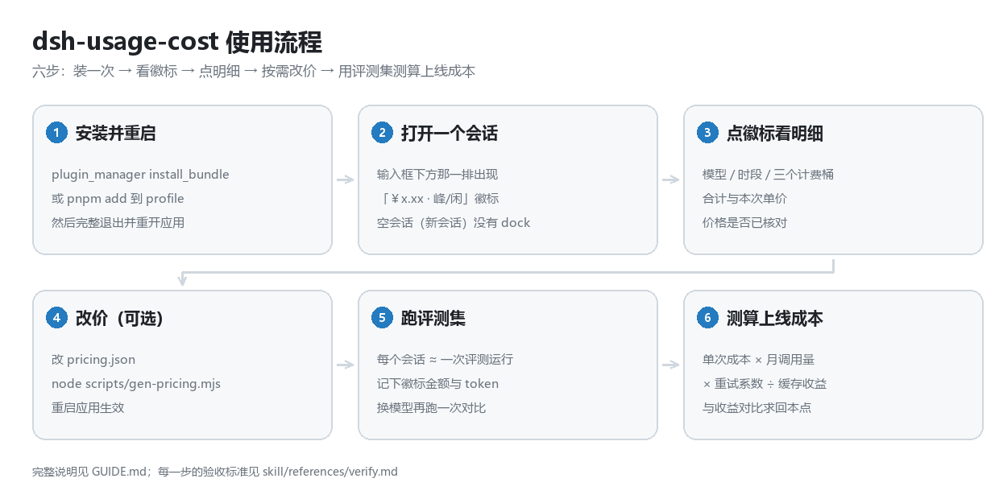
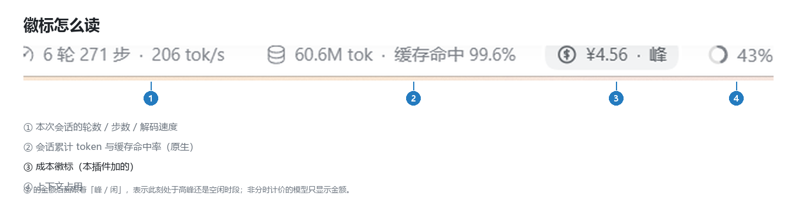
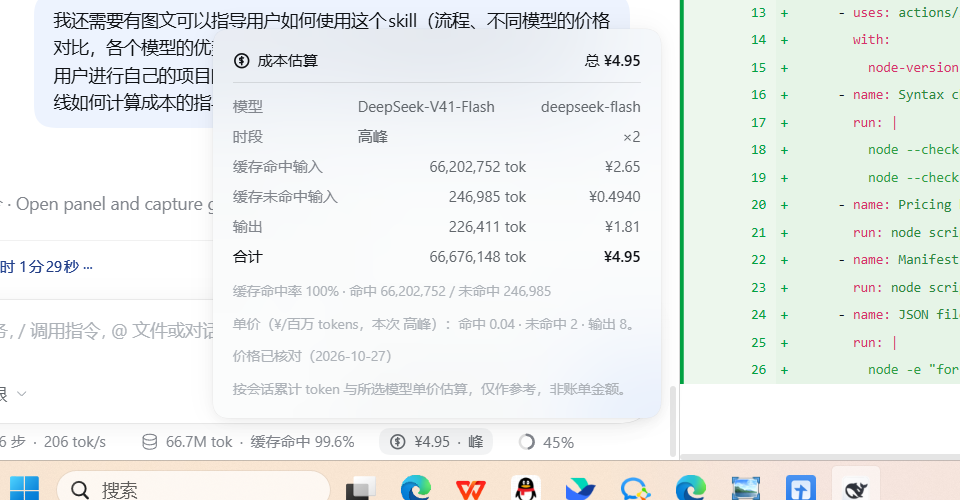
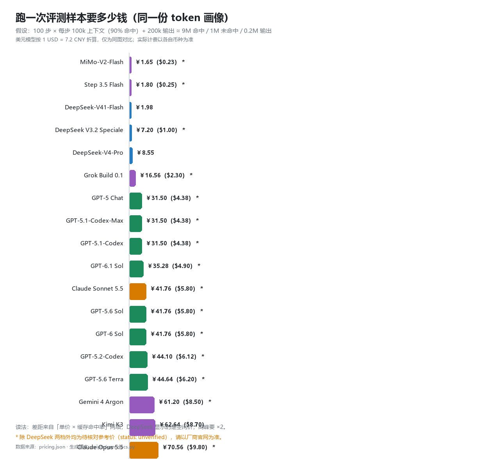
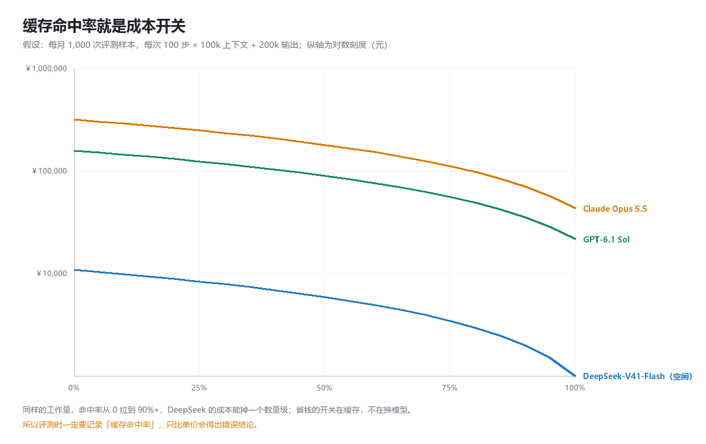
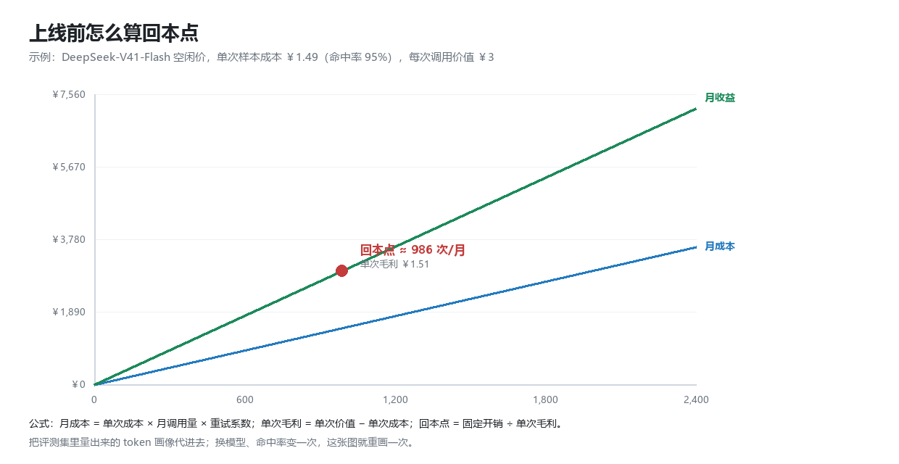
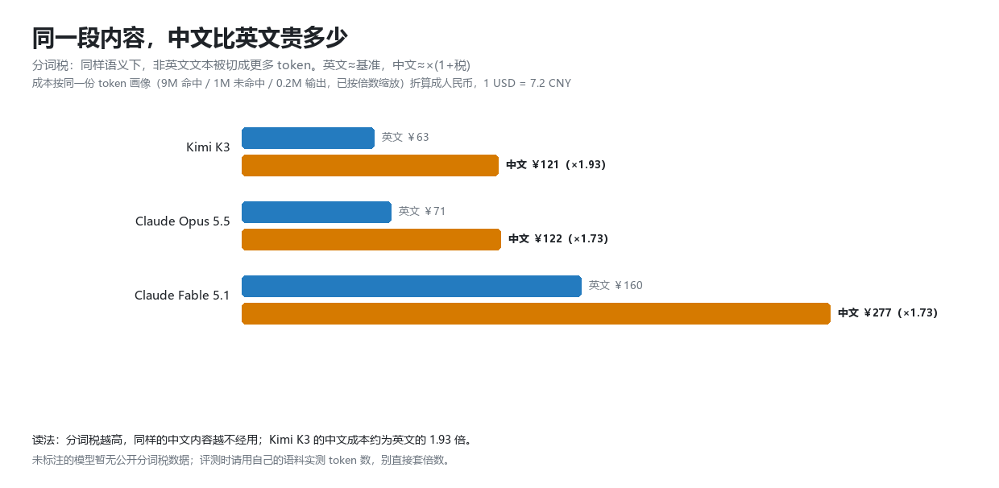

# 图文指南：从「大致估一下」到「用评测集算出上线成本」

这篇指南面向两类读者：

- 想立刻看到花了多少钱的人 —— 看第 1、2 节，五分钟搞定;
- 要拿 agent 上线、需要对成本与收益负责的人 —— 看第 3、4、5 节，里面有一套可以直接抄的测算方法;




---

## 1. 装一次，之后每次会话都自动有
```markdown
plugin_manager { action: "install_bundle", target: "<仓库目录或 github:you/dsh-usage-cost>" }
```
或手动：
```bash
cd "$DSH_PROFILE_DIR"
pnpm add "link:<仓库目录>"
# 然后把 "@local/dsh-usage-cost" 加进该 profile 的 dsh.profile.bundles
```
装完必须完整退出并重开应用——这个 Electron 外壳不响应页面刷新（Ctrl+R / F5 无效），热插入的插件行还可能把输入框那一条挤掉，重启即恢复。

装好之后不用再管它：每个会话都会自己算。

## 2. 徽标怎么读



输入框下面那一排本来是 Harness 自带的（步数 / token / 上下文），本插件在最右边那一格前面补了 ③ 成本：
### 徽标位置含义

| 位置 | 含义 |
| --- | --- |
| ① | 本次会话的轮数、步数、解码速度 |
| ② | 会话累计 token + 缓存命中率（**这个数字决定成本量级**） |
| ③ | 成本，`￥3.46 · 峰` / `￥3.46 · 闲`；美元模型显示 `$` 且没有峰/闲 |
| ④ | 上下文窗口占用 |



- 模型：按当前会话最后选用的模型匹配价目（id 与别名都认）
- 时段：DeepSeek 才有分时价，高峰 ×2、空闲 ×1
- 三个计费桶：缓存命中输入 / 缓存未命中输入 / 输出，各给 token 与金额
- 合计：徽标上显示的数字
- ⑤ 单价：本次生效的单价（元/百万 tokens），方便你核对是不是改价生效了
- ⑥ 核对状态：价格已核对 才代表价目表是对着官网填的；显示“价格待核对”说明这条还是参考值。


## 3. 模型怎么选：先看价格，再看优势

### 3.1 同一份工作量，价格差多少



图的假设是「跑一个评测样本」：100 步 × 每步 100k 上下文（90% 命中）+ 200k 输出，约等于 9M 命中 / 1M 未命中 / 0.2M 输出。

 #### 同一份工作量，价格差多少

| 模型 | 币种 | 缓存命中 | 未命中 | 输出 | 单样本成本（空闲/标准） | 状态 |
| --- | --- | --- | --- | --- | --- | --- |
| DeepSeek-V41-Flash | ￥ | 0.02 | 1 | 4 | **￥1.98**（高峰 ￥3.96） | ✅ 已核对 |
| DeepSeek-V4-Pro | ￥ | 0.15 | 4.5 | 13.5 | ￥8.55（高峰 ￥17.10） | ✅ 已核对 |
| GPT-5 mini | $ | 0.025 | 0.25 | 2 | ￥6.3 | ⚠️ 待核对 |
| Gemini 2.5 Flash | $ | 0.075 | 0.3 | 2.5 | ￥10.6 | ⚠️ 待核对 |
| Claude Haiku 4.5 | $ | 0.1 | 1 | 5 | ￥20.9 | ⚠️ 待核对 |
| GPT-5 | $ | 0.125 | 1.25 | 10 | ￥31.5 | ⚠️ 待核对 |
| Gemini 2.5 Pro | $ | 0.31 | 1.25 | 10 | ￥43.5 | ⚠️ 待核对 |
| Claude Sonnet 4.5 | $ | 0.3 | 3 | 15 | ￥62.6 | ⚠️ 待核对 |
| Claude Opus 4.1 | $ | 1.5 | 15 | 75 | ￥313 | ⚠️ 待核对 |

单位：每百万 tokens。美元列按 1 USD = 7.2 CNY 折算仅用于同图对比，真实账单按各自币种结算。除 DeepSeek 两档外都是待核对参考价，以厂商官网为准；改价见 pricing.json。

<!-- BEGIN:models -->
| 模型 | BenchGecko 均分（名次） | 输入 / 输出（每百万） | 缓存读 | 单样本成本 | 状态 |
|---|---|---|---|---|---|
| **GPT-5.5 Pro (#2)** | 98.3（#2） | $30 / $180 | $3 | ¥669.60 | ⚠️ 待核对（缓存价估） |
| **GPT-6 Astra (#3)** | 95.8（#3） | $10 / $50 | $1 | ¥208.80 | ⚠️ 待核对（缓存价估） |
| **DeepSeek V3.2 Speciale (#4)** | 95.2（#4） | $0.4 / $1.2 | $0.04 | ¥7.20 | ⚠️ 待核对（缓存价估） |
| **GPT-6.1 Sol (#5)** | 93.4（#5） | $2 / $10 | $0.1 | ¥35.28 | ⚠️ 待核对 |
| **Claude Opus 5.5 (#6)** | 91.8（#6） | $4 / $20 | $0.2 | ¥70.56 | ✅ 已核对 |
| **Step 3.5 Flash (#7)** | 89.5（#7） | $0.1 / $0.3 | $0.01 | ¥1.80 | ⚠️ 待核对（缓存价估） |
| **Gemini 4 Argon (#8)** | 89.2（#8） | $2 / $10 | $0.5 | ¥61.20 | ⚠️ 待核对（缓存价估） |
| **GPT-5 Chat (#9)** | 89（#9） | $1.25 / $10 | $0.125 | ¥31.50 | ⚠️ 待核对 |
| **GPT-5.1-Codex-Max (#12)** | 85.6（#12） | $1.25 / $10 | $0.125 | ¥31.50 | ⚠️ 待核对（缓存价估） |
| **Claude Opus 5 (#13)** | 84.6（#13） | $5 / $25 | $0.5 | ¥104.40 | ⚠️ 待核对（缓存价估） |
| **Claude Fable 5.1 (#14)** | 84.1（#14） | $10 / $50 | $0.25 | ¥160.20 | ✅ 已核对 |
| **Claude Opus 4.6 (Fast) (#15)** | 83.3（#15） | $30 / $150 | $3 | ¥626.40 | ⚠️ 待核对（缓存价估） |
| **Claude Fable 5 (#16)** | 82（#16） | $10 / $50 | $0.5 | ¥176.40 | ⚠️ 待核对（缓存价估） |
| **MiMo-V2-Flash (#18)** | 81.7（#18） | $0.09 / $0.29 | $0.009 | ¥1.65 | ⚠️ 待核对（缓存价估） |
| **Claude Sonnet 5.5 (#19)** | 81.7（#19） | $2 / $10 | $0.1 | ¥35.28 | ⚠️ 待核对（缓存价估） |
| **GPT-5.2-Codex (#20)** | 80.7（#20） | $1.75 / $14 | $0.175 | ¥44.10 | ⚠️ 待核对（缓存价估） |
| **GPT-5.4 Pro (#21)** | 79.7（#21） | $30 / $180 | $3 | ¥669.60 | ⚠️ 待核对（缓存价估） |
| **GPT-5.6 Sol (#23)** | 78.9（#23） | $2 / $10 | $0.2 | ¥41.76 | ⚠️ 待核对（缓存价估） |
| **GPT-6 Sol (#24)** | 77.9（#24） | $2 / $10 | $0.2 | ¥41.76 | ⚠️ 待核对（缓存价估） |
| **GPT-5.1-Codex (#25)** | 77.7（#25） | $1.25 / $10 | $0.125 | ¥31.50 | ⚠️ 待核对（缓存价估） |
| **Grok Build 0.1 (#26)** | 77.1（#26） | $1 / $2 | $0.1 | ¥16.56 | ⚠️ 待核对（缓存价估） |
| **GPT-5.6 Terra (#28)** | 75.3（#28） | $2 / $12 | $0.2 | ¥44.64 | ⚠️ 待核对（缓存价估） |
| **Kimi K3 (#54)** | 65.8（#54） | $3 / $15 | $0.3 | ¥62.64 | ✅ 已核对 |
| **GPT-5.5 (#58)** | 64.9（#58） | $5 / $30 | $0.5 | ¥111.60 | ⚠️ 待核对 |
| **DeepSeek-V41-Flash** | — | ¥1 / ¥4 | ¥0.02 | ¥1.98（空闲，高峰×2） | ✅ 已核对 |
| **DeepSeek-V4-Pro** | — | ¥4.5 / ¥13.5 | ¥0.15 | ¥8.55（空闲，高峰×2） | ✅ 已核对 |
> 单位：每百万 tokens；单样本成本按「100 步 × 每步 100k 上下文（90% 命中）+ 200k 输出」估算，美元按 1 USD = 7.2 CNY 折算。
> 均分是 BenchGecko 归一化平均（各模型被测基准不同，跨模型比较需谨慎）；`待核对` 表示价格尚未对着厂商官网确认。
> 由 `node scripts/gen-tables.mjs` 从 `pricing.json` 生成，请勿手改本区块。
<!-- END:models -->


### 3.2 各自的优势在哪儿（定性，以官方为准）

按场景选（价格与得分见 3.1 的表，数据每天在变，这里只给决策规则）：

| 场景 | 首选 | 理由 |
|---|---|---|
| 跑评测集 / 回归测试 | Step 3.5 Flash、MiMo-V2-Flash、DeepSeek-V41-Flash | 单样本成本个位数，量大时才谈得上迭代 |
| 线上 coding agent | Claude Sonnet 5.5、GPT-6.1 Sol、DeepSeek-V4-Pro | 得分 80+ 且缓存折扣好，命中率一上来就便宜 |
| 复杂重构 / 长时程任务 | Claude Opus 5.5、GPT-6 Astra、GPT-5.5 Pro | 前 6 名里 agentic 与 SWE 最稳，代价是单价 |
| 超长上下文 / 多模态 | Gemini 4 Argon、Kimi K3、GPT-6.1 Sol | 1M 级窗口，且长上下文不跳档（Gemini 需确认） |
| 中文为主的内容 | 先比「单价 × 分词税」 | Kimi K3 中文多耗 93% token，便宜单价会被吃掉一半（见 4.5） |
| 预算极低 | MiMo-V2-Flash、DeepSeek V3.2 Speciale | 开源权重，聚合站价格可到 $0.1/M 以下 |

判断规则：

- 1. **先看能不能过你的评测集**（准确率/通过率），过了再比价格——不过线的模型再便宜也没意义
- 2. **再看「单样本成本 × 月调用量」**，不是看每百万 token 报价（4.1～4.4 的公式）
- 3. **最后看缓存命中率**：这条能把顺序整体翻盘，见第 6 步那张曲线
- 4. 中文业务再加一层**分词税**修正（4.5）

> 具体每个模型擅长什么，官方模型页与 BenchGecko 的单模型页（如 [Kimi K3](https://benchgecko.ai/model/kimi-k3)、[Claude Opus 5.5](https://benchgecko.ai/model/claude-opus-5-5)）有分项成绩；本表刻意不写死"某某最强"，因为半年内就会过期。

**选型建议（按场景）**

- **跑评测集、刷回归**：`DeepSeek-V41-Flash` 或 `GPT-5 mini`，把命中率喂到 90%+ 后单样本就是几毛到一两块
- **线上 coding agent**：`Claude Sonnet 4.5`（质量）或 `DeepSeek-V4-Pro`（成本），两者都吃缓存
- **超长文档/多模态理解**：`Gemini 2.5 Pro` / `DeepSeek-V41-Flash`
- **高吞吐、低价值单次任务**：`Haiku 4.5` / `GPT-5 mini`
- **要不要上 Opus**：只有当「一次失败重试的成本 > 模型差价」时才值得


## 4. 用评测集测算上线成本：七步法

### 第 1 步：定义评测单元

一个样本 = 一次完整会话（不是一次 API 调用）。要固定三件事：任务定义、允许的步数上限、成功判定标准。否则后面算出来的单次成本没法比。

### 第 2 步：跑一遍，把 token 画像记下来

用本插件：一个会话就是一次评测运行，徽标上的金额直接可读。同时把 tokenUsage 的四个桶记下来（命中 / 未命中 / 缓存写入 / 输出），这四个数决定成本，其余都是叙事。

| 要记的字段 | 从哪来 | 为什么 |
|---|---|---|
| 步数 | 徽标 ① | 成本 ≈ 步数 × 上下文重发 |
| 命中 / 未命中 / 输出 token | 徽标 ② 点开的明细 | 三个桶单价差 10–100 倍 |
| 缓存命中率 | 徽标 ② | 决定成本量级（见第 6 步） |
| 会话金额 | 徽标 ③ | 直接就是单次成本 |
| 是否重试、是否成功 | 你自己标注 | 失败重试要摊进成本 |

### 第 3 步：算单次成本
```markdown
单次成本 = (命中 tok × 命中价 + 未命中 tok × 未命中价 + 输出 tok × 输出价) ÷ 1,000,000
```
例子（DeepSeek-V41-Flash 空闲价，9M / 1M / 0.2M）：
```markdown
9 × 0.02 + 1 × 1 + 0.2 × 4 = 0.18 + 1.00 + 0.80 = ￥1.98
```
同样的画像换 DeepSeek-V4-Pro（空闲）是 ￥8.55，换 Claude Sonnet 4.5 约 ￥62.6。

### 第 4 步：放大到月成本
```markdown
月成本 = 单次成本 × 日均调用量 × 30 × 重试系数
重试系数 = 1 + 失败率 × 平均重试次数
```
例：单次 ￥1.98、日均 300 次、失败率 8%、平均重试 1.5 次
```markdown
月成本 = 1.98 × 300 × 30 × (1 + 0.08 × 1.5) = 1.98 × 9000 × 1.12 ≈ ￥19,958
```
别忘了三项常被漏掉的成本：

- 子代理 / 后台任务：它们各自计费，会话徽标只统计自己那条链路
- 工具侧费用：DeepSeek 的 Search / Fetch 从 2026-11-01 起按 ￥5 / 千次成功请求
- 计费失败与回滚：线上重跑、人工兜底的时间成本通常比 token 贵

### 第 5 步：做两三个场景，而不是一个平均值

| 场景 | 占比 | 单次成本 | 加权 |
|---|---|---|---|
| 简单问答/短任务 | 60% | ￥0.4 | 0.24 |
| 常规编码任务 | 30% | ￥2.0 | 0.60 |
| 复杂重构/长上下文 | 10% | ￥9.0 | 0.90 |
| **加权单次成本** | | | **￥1.74** |
用加权值去乘调用量，比用「平均值」靠谱得多——长尾任务会吃掉预算。

### 第 6 步：命中率敏感性（最容易被忽略的一项）



**同一份工作量、同一个模型，命中率从 0% 到 90%，月成本能差一个数量级**。所以：

- 评测时必须记录缓存命中率，否则不同模型/不同 prompt 结构的对比没有可比性
- 提高命中率的手段（固定系统提示前缀、别频繁改工具定义、把稳定内容放前面）通常比「换便宜模型」更省钱
- 反向也要防：命中率高是因为上下文几乎不变，可能意味着评测集太简单

### 第 7 步：收益侧与回本点


```markdown
单次毛利 = 单次价值 − 单次成本
回本点（次/月） = 固定开销 ÷ 单次毛利
```
例：一次调用替你省下 ￥3 的人力/一次转化价值 ￥3，单次成本 ￥1.49（命中率 95%），固定开销 ￥500/月
```markdown
单次毛利 = 3 − 1.49 = ￥1.51
回本点 = 500 ÷ 1.51 ≈ 331 次/月
```
**怎么估「单次价值」**：优先用「替换掉的人工时长 × 人力单价」，其次用「转化率提升 × 客单价」，最后才用「猜测」。价值估不准时，先把回本点算出来，再问自己「这个量级现实吗」。

### 4.5 中文与英文的费用差距（分词税）

同样一句意思，中文被切成多少 token 取决于模型的分词器——同样的内容，中文可能比英文贵 1.7～1.9 倍。


```markdown
中文成本 ≈ 英文成本 × (1 + 分词税)
分词税 = 非英文内容相对英文多消耗的 token 比例
```
**已知的公开数据**（同一内容、非英文 vs 英文的 token 增量）：
| 模型 | 分词税 | 中文成本倍数 | 说明 |
|---|---|---|---|
| **Kimi K3** | **+93%** | **×1.93** | 中文场景下这个"便宜模型"的优势会被吃掉一半 |
| Claude Opus 5.5 | +73% | ×1.73 | 与 Fable 5.1 同族分词器 |
| Claude Fable 5.1 | +73% | ×1.73 | — |
| 其他模型 | 暂无公开值 | — | 用自己的语料实测，别直接套倍数 |

#### 为什么这件事重要：
- 选型时把「单价 × 分词税」一起看，而不是只看每百万 token 报价。Kimi K3 的输入价只有 GPT-6.1 Sol 的 1/10，但中文内容多 93% token，实际差距会缩小
- 评测集的语料语言会直接改变结论：同一套题，英文版和中文版算出来的单次成本不可比
- 中英混排的会话更难估：建议分别统计两种语言的 token 占比，再按比例加权

**怎么实测**（比查表靠谱）：

- 挑 20 条真实中文样本、20 条等义英文样本
- 各自只发一次、不要命中缓存，记录 usage 里的输入token
- 分词税 = 中文 token / 英文 token − 1
- 把这个数值写进 pricing.json 对应模型的 tokenizerTaxPct 字段，图和表会随之更新

> 提醒：pricing.json 里的 93% / 73% 来自 BenchGecko 的 Tokenizer Tax 测试，属于第三方测量；你自己的业务语料可能更高或更低。

#### 还有一个坑：换模型时 token 数本身会变

上面的分词税只描述同一个模型内中英文的差异。跨模型还有第二层偏差：

> Claude 4.7 及之后的模型（含 Fable 5.1）换了新分词器，同样的文本比 Sonnet 4.6 及更早的模型多出约 30% token。

这意味着我们前面所有「假设 token 数不变、只比单价」的对比都只是近似：
| 场景 | 偏差方向 | 影响 |
|---|---|---|
| 从旧 Claude 迁到 Fable 5.1 | token 数 +30% | 只比较单价会低估约 30% 的成本 |
| 中英混排 + 新分词器 | 两者叠加 | 中文在新模型上可能比英文贵 2 倍以上 |
| 同一份 prompt 跨模型对比 | 各自分词器不同 | **必须各自实测 token，不能复用一份统计** |

做法：

- 换模型前，用同一批真实请求在新模型上跑一次，读 usage 里的 input token，而不是沿用旧模型的统计
- 把「模型 × 语料」两个维度分开记录：tokens_in 随模型变，price 随模型变，成本是两个变量的乘积
- 评测集如果跨模型复用，报告里要写清楚「token 数取自哪个模型」，否则单次成本不可比

> 来源：Claude Fable 5.1 API 价格（blog.laozhang.ai，2026-09-25 更新） 与 Anthropic 官方 Pricing 文档。

### 4.6 缓存写入才是 agent 账单的大头（实测）

这是最容易看反的一件事：缓存命中率 93%，钱却主要花在缓存写入上。

一份对 6 个长期运行的 Claude Code 会话的实测（7,850 轮、29 亿输入侧 token）给出了这样的结构：
| 输入侧 token 构成 | 占比 |
|---|---|
| 未缓存 input | **0.015%** |
| 缓存写入 | 6.6% |
| 缓存读取 | **93.4%** |

但按 Opus 5.5 价目（写入 $5/$8，读取 $0.20）折算成费用占比：
| 费用项 | 占 token 用量 | 占总费用 |
|---|---|---|
| 缓存读取 | 93.4% | **23.7%** |
| 缓存写入 | 6.6% | **67.1%** |

原因就是单价：读取 token 数是写入的 14.1 倍，但一小时写入单价是读取的 40 倍（$8 vs $0.20）。

怎么用这条结论：

- 先看写入，再看读取。压缩上下文只减读取，收益有限；让前缀失效（改系统提示词、改工具定义、插了又删的文件）才是真正的浪费
- 判断公式：读取费用 > 写入费用的临界条件是 读取 token ÷ 写入 token > 写入单价 ÷ 读取单价。Opus 5.5 一小时缓存是 40:1，实测 6 个会话在 7.5:1～30.4:1 之间，全低于门槛，所以写入更贵
- TTL 别默认选一小时。扣除被替代的读取费用后，Opus 5.5 的条件是「改用 5 分钟缓存会让写入量增加 62.5% 以上」才划算；间隔一两分钟一轮的会话，1 小时 TTL 基本是白付钱
- 预算用混合单价，别用输入标价。同一批用量下 Opus 5.5 的输入侧混合单价是 $0.717/百万，只有标价 $4 的 1/5.6

> 数据来源：Opus 5.5 调价测算（bestagent.dev，2026-09-24）。样本是一台机器上的 6 个会话，作者自己也强调不能外推到所有代理任务——但这个量级差异值得你在自己的日志里核一遍。本插件的弹层把「缓存写入」单列一行，就是为了让这一项可见。

## 5. 一页纸模板（直接抄进你的测算表）
```markdown
【输入】
模型： DeepSeek-V41-Flash → 单价 命中0.02 / 未命中1 / 输出4（空闲）
评测样本数： 50
单样本 token 画像： 命中 9.0M / 未命中 1.0M / 输出 0.2M （来自插件实测）
缓存命中率： 90%
平均步数： 100
失败率 / 平均重试： 8% / 1.5 次

【单次】
单次成本 = 1.98 元
含重试 = 1.98 × (1 + 0.08×1.5) = 2.22 元

【月度】
日均调用 300 次
月成本 = 2.22 × 300 × 30 ≈ 19,958 元
工具费 = Search/Fetch 次数 × 5 / 1000 元
人工兜底 = 失败率 × 次数 × 单次人工成本

【收益】
单次价值 3.0 元
单次毛利 3.0 − 2.22 = 0.78 元
月毛利 = 0.78 × 9000 ≈ 7,020 元 ← 为负就说明这个模型/场景不成立
回本点 = 固定开销 ÷ 0.78

【决策】
毛利率、回本点、失败率三者一起看；只盯单次成本会选出更贵的方案。
```
## 6. 常见误区
| 误区 | 现实 |
|---|---|
| 「按每百万 token 单价选最便宜的模型就行」 | 命中率、输出占比、重试率能把排名完全打乱 |
| 「一次 API 调用 = 一个评测样本」 | 一个 agent 样本往往是几十上百次调用 |
| 「用平均值估算就行」 | 长尾任务的单次成本可能是均值的 5 倍以上 |
| 「省 token 就是省成本」 | 命中价只有未命中价的 1/25（DeepSeek），结构比总量更重要 |
| 「会话徽标 = 账单」 | 它是估算：按会话累计值 × 当前模型单价，不分段、不含工具费与子代理 |

## 7. 什么时候该重新测

- 换模型、换 prompt 结构、换工具集（都会改变缓存命中率）
- 平均步数变化超过 
- 30%厂商调价（改 pricing.json → node scripts/gen-pricing.mjs → 重启）
- 评测集本身扩容或难度调整

---

需要更细的操作细节（怎么改价、怎么排查徽标不出现），看 README.md 与 skill/references/。
